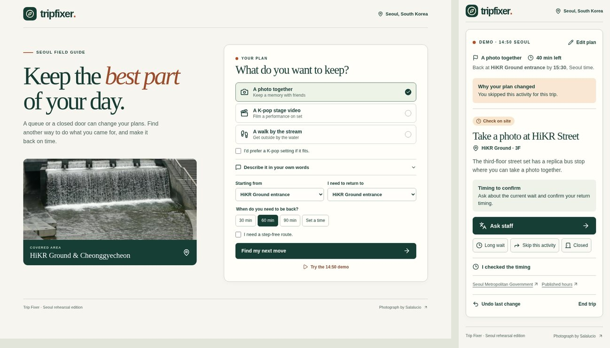

# TRIP FIXER · 서울 여행 복구 리허설

서울에서 일정이 틀어진 외국인 여행자가 **지키고 싶은 경험과 돌아갈 약속**을 입력하면, 현장에서 할 수 있는 다음 행동을 하나 보여준다. 여행자 화면은 영어·일본어·중국어(간체)·프랑스어를 지원하고, 직원에게 보여줄 문장은 한국어로 제공한다. 다루는 구역은 하이커 그라운드 2·3층과 청계천 광교 입구다.

[실행 중인 리허설](https://trip-fixer-rehearsal.vercel.app)

[최종 설계·기술 선택·14시간 현장 제작·배포 검수](docs/final/README.md)

## 40초 체험

1. 첫 화면 아래 **Try the 14:50 demo**를 누른다. 금요일 14:50, 두 사람이 함께 사진을 남기고 싶고 가능하면 K-pop 촬영을 선호한다. 15:30 정문 약속이 있다.
2. 2층 무대에서 **Long wait → 45 min**을 누른다. 가장 빨라도 15:35부터 촬영할 수 있어 2층을 제외한다. 3층 버스 정류장 포토존과 **Check on site**가 뜬다.
3. **Ask staff**를 눌러 3층 이용 여부를 묻는 한국어 문장을 보여준다. 실제로 확인한 네 구간의 시간을 넣으면 예상 복귀 시각이 표시된다.
4. **Undo last change → Edit plan → A K-pop stage video**로 목표를 바꾸고 같은 45분을 입력해 본다. 무대 촬영이 꼭 필요한 경우에는 같은 목표로 가능한 후보가 없다고 안내한다. **My timing reports**에서 새 대기를 입력할 수 있다.

데모 시계는 2026-11-27 14:50 KST에 고정한다. 일반 시작 버튼은 서버의 현재 서울 시각을 쓴다. 영업시간·층별 정보는 출처를 붙인 편집 자료다. 당일 대기·현장 통제·이동 시간은 여행자가 확인한다.

## 내 컴퓨터에서 실행

Node.js 24와 npm을 사용한다. 다음 명령을 저장소 폴더에서 차례로 실행하고 브라우저에서 http://localhost:3000 을 연다.

~~~sh
npm ci
npm run dev
~~~

버튼 흐름은 바로 동작한다. 영어 메모 해석을 켜려면 .env.example을 .env.local로 복사하고 본인 개발 환경에 OPENAI_API_KEY를 설정한다. Vercel에서는 프로젝트의 Environment Variables에 값을 넣고 다시 배포한다. 기본 모델은 gpt-6-luna다. 메모 읽기 버튼을 직접 눌러야 모델로 전송되며, 결과를 적용하기 전에 사용자가 한 번 확인한다. 코드나 이슈에 실제 키를 입력하지 않는다.

## 어디부터 읽을까

| 작업 | 파일 | 직접 확인할 것 |
|---|---|---|
| 시간을 판단한다 | [lib/recover.ts](lib/recover.ts) | 추천, 현장 확인, 제외 결과가 어떤 입력에서 나오는가 |
| 영어 입력과 AI 경계를 확인한다 | [lib/interpret.ts](lib/interpret.ts) · [API 처리](app/api/recover/route.ts) | 모델 실패·형식 불일치 때도 버튼으로 진행 가능한가 |
| 장소 정보를 고친다 | [목록](data/activities.json) · [근거](docs/SOURCES.md) | 장소·층과 당일 운영을 구별했는가 |
| 화면을 바꾼다 | [목표 선택](components/SetupForm.tsx) · [복구 카드](components/ResultCard.tsx) | 변경의 대상, 복귀 시각, 한국어 질문이 보이는가 |
| 직접 모델과 일을 나눠본다 | [개발 및 인수 안내](docs/HANDOFF.md) | 한 번에 한 조건을 바꾸고 실패→성공을 확인하는가 |
| 테스트와 오픈소스를 본다 | [테스트](tests) · [CI](.github/workflows/ci.yml) · [SBOM](docs/sbom.cdx.json) · [고지](public/third-party.txt) | 테스트와 실제 배포 점검을 구분했는가 |

## 검증 명령

~~~sh
npm test
npm run build
npm run typecheck
npx playwright install chromium --only-shell
npm run test:e2e
npm sbom --sbom-format cyclonedx --package-lock-only > docs/sbom.cdx.json
~~~

Playwright가 빌드된 앱을 시작한다. Linux에서 브라우저 시스템 패키지가 필요하면 설치 명령에 --with-deps를 더한다. 이미 설치한 Chromium은 PLAYWRIGHT_CHROMIUM_EXECUTABLE_PATH로 지정할 수 있다. 실제 메모가 외부로 전송되는 시험은 키를 설정한 팀의 별도 선택이다.

## 대회와의 관계

연습용 공개 소스다. 본선 현장에서는 빈 저장소에서 다시 작성한다. 공식 FAQ는 핵심 서비스와 코드의 현장 개발, 공개 라이브러리와 기본 환경 허용, 라이선스 제한과 SBOM 제출을 설명한다. 연습 결과와 문서·프롬프트·데이터셋의 현장 참고 범위, 비참가 외부 멘토 역할은 운영사 답변을 확인해야 한다. [2026 서울관광 프롬프톤 공식 FAQ](https://prompt2026.sto.or.kr/)
