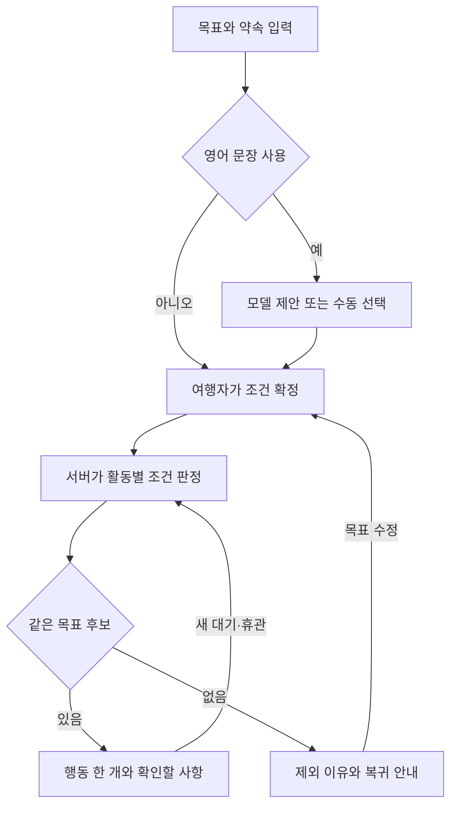
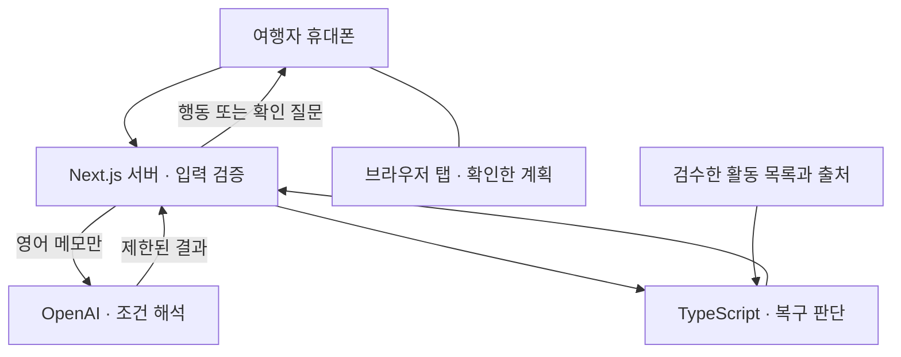

# TRIP FIXER 시스템 설계 기준서

2026-11-26 · 트랙 1 · 팀 검토본 v1.0  
대상은 제품 결정자, 구현자, 검수자, 인수 운영자다. 아래에서 ‘검증’은 지정한 리허설 버전에서 재현했다는 뜻이다. 제품 수요와 본선 승인 상태는 별도로 관리한다. [검토한 구현 버전](https://github.com/esm5678-dot/TRIP-FIXER/tree/276204bdc07994b093f26adad6b792866e73dc3c)

## 1. 문제와 제품 경계

서울을 개별 여행하는 외국인이 이미 도착한 장소에서 긴 대기나 휴관을 만났을 때, 자신이 지키려던 경험과 다음 약속을 함께 만족시킬 행동을 정하도록 돕는다. 성공 기준은 여행자가 **다음에 무엇을 할지, 무엇을 현장에서 더 확인해야 할지** 직접 설명하는 것이다. 실제 문제 빈도, 이탈률 개선, 기존 서비스 대비 선택 시간 단축은 미확인이다.

기존 기획의 ‘여행이 실망스러울 때 취향을 찾아주는 서비스’에서 **현장 사건 이후 일정 한 구간 복구**로 범위를 좁혔다. 신청서 1·2·3·5번을 합칠 때 이 범위와 일치시킨다. 영어 화면, 하이커 2층 무대·3층 포토존·청계천 광교 입구 세 활동, 다음 행동 한 개가 이번 범위다. 서울 전역 검색, 실시간 대기 수집, 예약, 계정, GPS는 제외한다.

## 2. 요구사항과 인수시험

| ID | 여행자가 해야 하는 일 | 화면과 서버의 책임 | 인수 기준 | 리허설 근거 |
|---|---|---|---|---|
| R1 | 꼭 원하는 경험과 가능하면 원하는 조건을 구분한다 | 시작 화면에서 목표를 확인하고 판단 규칙은 필수 목표부터 검사한다 | 같은 45분 대기에서 사진 목표는 3층 확인, 무대 영상 필수는 후보 없음 | 규칙 시험의 strict stage와 45-minute wait, 브라우저의 strict goal |
| R2 | 약속을 지킬 수 있는지 판단한다 | 서버가 서울 시각, 이동·대기·체험·복귀를 계산한다 | 14:50에 3+4+10+6분, 운영 확인까지 있으면 예상 복귀 15:13. 모르는 시간이 있으면 현장 확인 | four checked estimates, unknown queue |
| R3 | 한 번 말한 목표를 유지하며 현장 상황만 수정한다 | 대기는 활동별 최신 보고로 교체한다. 휴관은 체험과 건물 중 범위를 받는다 | 2층만 닫으면 3층 유지, 건물 전체면 두 곳 제외. 대기 수정은 이전 값에 더하지 않는다 | activity closure, building-wide closure, new queue |
| R4 | 접근 조건과 운영시간을 지킨다 | 출처 있는 계단·운영일·입장 마감과 사용자 동선을 대조한다 | 무계단 필수면 광교 계단 제외. 하이커 월요일과 입장 마감 경계 판정 | Gwanggyo stairs, published Monday, last entry |
| R5 | 다음 행동을 현장에서 실행한다 | 결과에 한국어 직원 질문과 영어 뜻, 원문 출처를 붙인다 | 휴대폰에서 질문을 열 수 있고, 후보가 없으면 약속 장소 검색 또는 목표 수정 가능 | desktop demo, strict goal, mobile whole-venue |
| R6 | 중단이나 번복 뒤 이어간다 | 탭에 확인된 조건과 보고를 저장하고 변경 취소 시 현재 시각으로 재계산한다 | 새로고침으로 마감 연장 없음. 출발지 수정 시 예전 이동 검증을 해제. 종료 시 탭 기록 삭제 | relative budget, reload/end, origin edit |
| R7 | 영어 한 문장을 쓰고 해석을 직접 승인한다 | 모델은 목표·선호·접근 조건만 제안한다. 사람이 채택한 뒤 규칙에 반영한다 | 거절·비정상 출력·호출 실패 때 목표 버튼 유지. 사용 전 제안이 기존 목표를 덮어쓰지 않는다 | 모델 대역 시험, 브라우저의 note needs confirmation. 실모델 정확도는 미측정 |

[규칙 시험](../tests/recover.test.ts) · [모델 경계 시험](../tests/interpret.test.ts) · [사용자 흐름 시험](../tests/browser/recovery.spec.ts)

## 3. 사용자 흐름과 예외

시작 화면은 목표, 출발지, 복귀 지점, 마감, 접근 조건을 받는다. 결과 화면에는 남은 시간과 약속을 계속 표시한다. 대기 선택은 ‘Long wait → 시간’ 두 번, 건너뛰기는 한 번으로 적용한다. ‘Ask staff’는 질문을 펼친다. ‘Undo’는 마지막 변경 한 건을 취소하고 다시 판정한다. 데모는 고정 시각, 일반 모드는 서버의 현재 시각을 사용한다.

판정 순서는 **필수 목표·접근·휴관 → 운영·시간 제약 → 확인한 후보 우선 → 명시한 선호 → 고정 순서**다. 미확인 후보와 확인한 후보를 화면에서 구분한다. 15:30 마감인데 대기만으로 15:30에 도달하면 체험할 시간이 없어 제외한다. 반대로 5분 대기는 나머지 세 구간에 대한 정보가 없으므로 도착을 보장하지 않는다.

## 4. 시스템 구조와 데이터 책임

| 데이터 | 기준을 정하는 주체 | 수명과 실패 처리 |
|---|---|---|
| 활동, 층, 접근 방식, 시설 운영시간 | 운영 담당자가 시설 공식 안내·현장 기록을 대조 | 변경 시 카드와 시간 규칙, 경계 시험을 함께 갱신. 당일 가용 여부는 사용자에게 확인 |
| 목표, 선호, 출발·복귀·약속 | 여행자가 최종 확인 | 해당 탭과 여행일 기준. 상대시간은 처음 한 번 절대 마감으로 변환 |
| 대기·휴관·이동 추정 | 여행자가 대상과 범위를 지정 | 보고 시각과 함께 보관. 최근 긍정적 시간 확인은 10분 경과 시 재확인 |
| 원문·모델 제안 | 사용자가 읽기를 눌렀을 때 서버가 해석 요청 | 원문을 탭 저장소에 보관하지 않는다. 서버 키 사용. 모델 제안에는 장소 생성·운영 판정 권한이 없다 |

**인터페이스.** 한 서버 경로가 ‘문장 해석’과 ‘계획 평가’를 처리한다. 해석은 확인할 제안 또는 수동 선택 안내를 반환한다. 평가는 계획·관측·변경을 받아 남은 시간, 다음 행동, 제외 이유를 반환한다. 잘못된 형식과 과도한 요청은 거절한다. 연결 실패 시 화면은 직전 계획과 재시도를 제공한다. 요청 순번으로 늦은 응답이 최신 선택을 덮어쓰는 것을 막는다. [입출력 계약](../lib/contracts.ts) · [서버 처리](../app/api/recover/route.ts)

## 5. 주요 선택과 검증 한계

| 선택 | 이유와 대안 | 후속 검증 |
|---|---|---|
| TypeScript와 Next.js 한 앱 | 화면과 서버가 같은 조건을 쓰고 한 곳에 배포된다. Java 서버를 분리하면 요청 형식과 배포 두 곳을 관리해야 한다. | 팀원이 조건 하나를 바꾸고 관련 시험을 스스로 찾는지 확인 |
| 규칙 계산 + 선택형 모델 호출 | 시간과 휴관은 반복 가능한 판정이 필요하다. 전부 모델에 맡기면 같은 제한을 일관되게 시험하기 어렵다. | 승민이 직접 정한 필수·선호·모호 문장으로 모델별 정답·지연·비용 비교 |
| 검수 목록 + 탭 저장 | 세 활동의 근거를 운영자가 추적할 수 있다. 광역 검색 API와 중앙 DB는 이번 핵심 흐름에 추가 운영 부담이 크다. | 확인일 경과·시설 임시 변경을 운영자가 발견해 카드 수정할 수 있는지 시험 |
| GitHub 검증 + Vercel 배포 | 변경 검증과 휴대폰 접속을 팀원이 반복할 수 있다. | 실제 현장 계정·장비에서 빈 저장소부터 배포까지 시간 실측 |

보안·운영 검수 항목은 서버 전용 키, 입력 길이 제한, 허용된 모델 출력값, 타임아웃, 개인정보 최소 수집, 배포물 의존성 목록이다. 인스턴스별 호출 제한만으로 전체 비용을 보장할 수 없다. 계정별 예산·소유권·키 교체는 인수 시 확인한다. [선택표·라이선스](SOURCES.md) · [운영 인계](HANDOFF.md)

## 6. 설계 승인과 변경 절차

| 남은 판단 | 제안하는 검수 방법 | 완료 증거 |
|---|---|---|
| 사용자 문제와 사용성 | 외국인 사용자에게 45분 상황을 주고 설명 없이 조작하게 한다. 목표 유지 여부, 완료 시간, 미확인 사항을 설명했는지 기록한다. | 참여 인원·원문 관찰·실패 사례. 검증 전에는 성과 수치로 사용하지 않는다. |
| 서비스 모델 선택 | 영어 예문과 기대값을 먼저 고정하고 동일 문장으로 후보 모델을 비교한다. | 승민이 선택한 모델명, 오분류, 실호출 지연·비용 기록 |
| 본선 범위와 인수 | 주최 측에 사전 문서 참고 범위와 LGPL 선택 의존성의 인수 기준을 확인한다. | 답변 원문과 실제 본선 배포물 SBOM |
| 14시간 실현성 | 참가 인원 기준으로 빈 환경부터 직접 재구현하고 배포·발표까지 잰다. | 구간별 실측 시간, 초과 시 제거할 항목 |
| 팀 승인 | 팀이 사례와 범위를 검토한다. 신청서 4·6·7번은 회의에서 별도 결정한다. | 승인일, 변경사항, 담당자가 적힌 결정 기록 |

승민은 제품 목표·모델을 선택하고 기능별 변경을 승인한다. 기술 검토자는 허용된 역할 범위에서 계약·시간 경계·배포를 검수한다. 요구사항을 바꾸면 해당 R번호, 달라지는 화면·판정, 이전과 이후의 기대 결과, 시험 결과를 한 변경 기록으로 남긴다. 위 표의 미결 항목까지 확인한 뒤 본선 설계 확정판을 발행한다.
