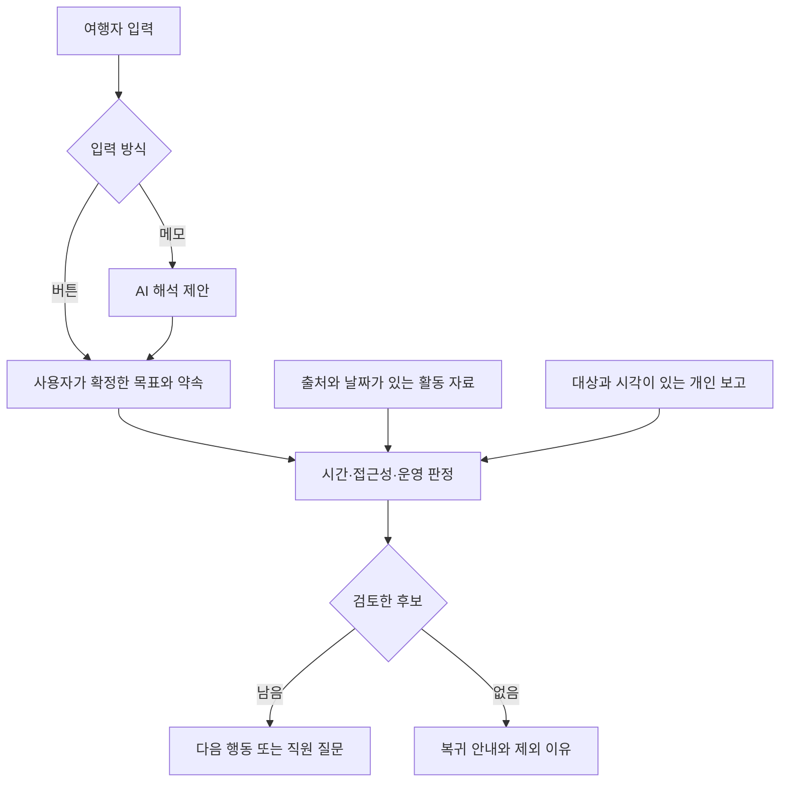

# TRIP FIXER · 모바일 여행 복구 설계 결정서

서울관광 프롬프톤 트랙 1 | 설계 검토 2026-11-27 | [코드 기준 1bbbe62](https://github.com/esm5678-dot/TRIP-FIXER/tree/1bbbe62bad8afa4650b5d793c8ffbf297f43daa8) · [휴대폰 화면 3장](../mobile-preview.jpg) · [리허설 앱](https://trip-fixer-rehearsal.vercel.app)

**서울에서 일정이 틀어졌을 때, 처음 원했던 경험과 다음 약속을 함께 지킬 수 있는 행동 한 가지를 알려 준다.** 추천하는 본선 범위는 하이커 그라운드 2층 무대, 3층 포토존, 청계천 광교 진입로의 세 활동이다. 개발 우선순위는 이미 표시한 답을 *언제 거둬들여야 하는지* 정확히 정하는 것이다.

## 1. 심사위원에게 보여줄 한 장면

금요일 14:50. 두 여행자 모두 15:30에 정문에서 친구를 만나야 한다. 직원이 2층 무대 대기를 45분이라고 알려준다. 가장 빠른 시작은 15:35다.

| 여행자가 꼭 지키려는 것 | 휴대폰이 제시할 다음 행동 | 화면에 남는 근거 |
|---|---|---|
| 함께 사진 한 장. K-pop 배경은 선호 | **3층 버스 정류장 포토존을 지금 쓸 수 있는지 직원에게 묻기** | 2층 제외 사유, 15:30 약속, 보여 줄 한국어 한 문장과 선택 언어의 뜻 |
| K-pop 무대 영상 자체 | **정문으로 돌아가기** 또는 본인이 목표 수정 | 검토한 무대 후보는 한 곳이다. 3층 사진은 영상 목표를 충족하지 않는다. |
| 직원이 대기를 5분으로 정정 | **2층 이용과 왕복 소요시간 확인하기** | 새 관측 시각과 대상. 짧은 대기만으로 복귀 성공을 확정할 수 없다. |

3층 포토존의 존재는 서울시 시민기자의 현장 기록에서, 전시층의 통상 운영시간과 마지막 입장은 한국관광공사에서 확인했다. 오늘 촬영 가능한지와 실제 대기는 여행자·직원의 현장 확인이 필요하다. [포토존 기록](https://mediahub.seoul.go.kr/archives/2018903) · [전시층 시간표](https://english.visitkorea.or.kr/svc/whereToGo/locIntrdn/rgnContentsView.do?vcontsId=31124) · [광교 진입로 자료](https://www.sisul.or.kr/open_content/cheonggye/enjoy/way.jsp)

### GitHub 구현에서 가져온 판단

여행·교통·장소 5개, 모바일 4개, AI 3개, 인수·테스트 4개 프로젝트를 확인했다. 두 영역에서 겹치는 Playwright를 한 번 세면 **외부 저장소 15개**다. 파일 단위 고정 링크와 라이선스는 표의 각 부록에서 확인할 수 있다. 후보 선정 기준은 TRIP FIXER에서 같은 입력·결정·실패를 재현할 수 있는지다. 인기도나 관광객 사용률은 이 조사에서 측정하지 않았다.

| 소스에서 확인한 패턴 | 우리 팀의 선택 | 본선에서 아낄 일 |
|---|---|---|
| OpenTripPlanner는 도착 기준 요청을 표현하고, Digitransit은 알림의 적용 시간을 검사한다. | 복귀 약속을 먼저 고정하고, 대기 보고의 대상과 시각을 검사한다. | 전 도시 길찾기 엔진 구축. [구현·라이선스 원문](research/TRAVEL.md) |
| GTFS Realtime은 정보 미수신과 지연 없음의 의미를 구분한다. StreetComplete는 접근 가능 여부의 범위를 기록한다. | 알려지지 않은 대기·접근은 ‘현장 확인’으로 표시한다. ‘광교 계단’의 근거는 해당 입구에만 쓴다. | 실시간 혼잡 추정과 서울 전체 무계단 인증. [구현·명세 원문](research/TRAVEL.md) |
| GOV.UK Frontend는 사용자가 놓치기 쉬운 상태에 초점을 보내고 Workbox는 네트워크 실패 처리를 분리한다. | 짧은 결과 안내, 만료 표시, 다시 시도를 설계한다. | 서비스워커·오프라인 지도의 추가 도입. [모바일 근거](research/MOBILE.md) |
| OpenAI의 구조화 응답 예제는 필드를 제한하고 검증된 결과를 사용한다. | 메모의 목표·선호·접근 요구만 제안하고 수락 전후를 검수한다. | 추천 전 과정을 모델에 맡기거나 자동 모델 전환을 구성하는 일. [코드와 모델 선정 기준](research/AI.md) |

## 2. 현재 가능한 것과 다음 구현

현재 공개 리허설에는 휴대폰 두 단계 입력, 네 언어, 목표별 후보 선택, 현장 변경과 취소가 있다. 320·360·390·430px에 각각 배정한 한 언어의 회귀 시험이 있다. 한 커밋에서 수행한 28개 단위 시험의 통과와 아래에서 새로 재현한 실패는 함께 성립한다. 아래 ‘통과 조건’은 다음 구현을 위한 기준이다.

| 우선 | 현재 확인한 차이 | 다음 구현의 통과 조건 |
|---|---|---|
| P0 · 개장 전 | 금요일 09:40, 09:55 복귀, 무대는 10시 개장이다. 09:28에 적은 0분 대기를 더하면 후보가 다시 나타난다. | 유효기간이 지난 보고가 있어도 개장 전에 돌아와야 할 무대는 제외한다. |
| P0 · 대기 시계 | 14:50에 35분 보고, 15:30 마감. 새 보고 없이 14:50·14:55·15:00에 판정이 확인·제외·확인으로 바뀐다. | 보고 직후의 가장 빠른 시작 15:25를 보존한다. 14:55에 35분을 새로 더하지 않는다. 15:00에는 현재 대기를 다시 묻고, 15:30에는 복귀를 안내한다. |
| P0 · 접근 조건 | 현재 AI 제안의 기본값이 사용자가 이미 켠 무계단 조건을 덮어쓸 수 있다. | 목표가 사진인 메모에 계단 언급이 없어도 이전 무계단 선택 유지. 해제는 사용자의 명시적인 조작으로만 가능하다. |
| P1 · 이동 증거 | 화면은 복귀 장소 편집 시 동선 확인을 지운다. 서버 판정 함수에 예전 확인값을 넣자 다른 복귀 장소에도 14:57을 표시했다. | 정문 복귀로 확인한 14:57 예상값을 광교 복귀에 제출하면 서버도 ‘동선 재확인’으로 처리한다. 시설 휴관 보고는 보존한다. |
| P0 · 끊긴 연결 | 이미 열린 탭에서 갱신 실패 시 오류와 함께 이전 카드가 남는다. 예전 ‘시간 내 가능’ 표시가 계속 보일 수 있다. | 마지막 확인 시각과 ‘재확인 필요’를 표시한다. 오프라인에서 약속이 지나면 예전 가능 배지를 거두고 복귀 약속을 표시한다. |
| P0 · 새 결과 읽기 | 모바일 입력 단계 이동에는 제목 초점 처리가 있다. 결과 카드와 후보 없음 화면은 제목을 만들지만 명시적으로 초점을 보내지 않는다. | 사용자가 버튼으로 새 결과를 요청하면 제목이 한 번 읽힌다. 시간 갱신만으로 현재 초점을 옮기지 않는다. |

[로컬 재현과 판정 감사](research/RULES.md) · [모바일·접근성 근거](research/MOBILE.md) · [AI 적용과 모델 평가](research/AI.md)

## 3. 휴대폰 화면과 판정의 책임

| 사용 순간 | 앞에 놓을 정보/버튼 | 동작 |
|---|---|---|
| 처음 열기 | 사진·무대 영상·산책 | 경험 한 개 선택. 무대 배경 선호와 무대 촬영 필수를 별도로 표현한다. 메모는 선택 입력이다. |
| 복귀 정하기 | 출발지, 복귀 장소, 서울 시각, 무계단 조건 | 확정 순간 상대시간을 당일 마감 시각으로 고정한다. 언어 또는 이전 단계를 바꿔도 보존한다. |
| 대기·중단 발생 | 결과 카드의 ‘긴 대기’, ‘휴관’, ‘건너뛰기’ | 대기는 해당 체험에만, 휴관은 체험 또는 시설에 적용한다. 다음 행동 1개, 제외 이유, 기존 약속을 함께 표시한다. |
| 확인·정정 | 직원에게 보여 줄 한국어, 새 대기, 마지막 변경 취소 | 문장의 뜻은 여행자 언어로 보여 준다. 새 보고는 같은 대상의 이전 보고를 교체하고 현재 시각으로 다시 판정한다. |
| 복귀/통신 실패 | 복귀 장소·시각, 최근 확인 시각, 다시 시도 | 열려 있는 탭은 마지막 약속을 보여준다. 새 탭의 완전한 오프라인 동작은 본선 범위 밖이다. 지도 링크의 작동도 연결 상태에 달렸다. |

화면은 320px 프랑스어에서 줄바꿈을 허용한다. 핵심 버튼의 높이는 44 CSS px 이상으로 검수하고, 결과 전환 후 결과 제목에 초점을 보낸다. 자동 갱신은 읽고 있던 초점을 빼앗지 않는다. 당일 수치 안내, 대기 수정, 후보 없음, 네트워크 실패 문구까지 네 언어로 확인한다.

### 판정 순서

1. **마감과 고정 조건.** 서울 날짜·복귀 마감, 필수 목표, 알려진 계단, 적용 범위가 맞는 휴관·건너뛰기를 검사한다. 개장 전이라도 개장 후 시작해 복귀할 수 있는 경우는 남긴다. 개장 시각이 마감 이후라면 어떤 오래된 보고도 살려내지 못한다.
2. **대기 관측의 의미.** 직원이 알려준 분 수는 그 시점의 추정치다. 처음 기록할 때 관측 시각을 붙인다. 가장 빠른 시작을 계산할 때 현재 시각, 개장과 관측 시각+대기 중 해당하는 가장 늦은 값을 사용한다. 줄에 실제 합류했다는 추측이나 남은 대기 카운트다운을 표시하지 않는다. 기존 데모처럼 관측한 대기 종료가 마감과 같거나 늦으면 새 보고 또는 취소 전까지 해당 근거로 제외한다. 유지한 제외 사유에는 보고 시각을 표시하고 정정 버튼을 제공한다.
3. **이동과 접근 증거.** 네 구간(도착까지 이동, 대기, 체험, 복귀)의 추정치, 이용 가능 확인, 필요한 경우 왕복 무계단 확인이 있어야 ‘입력한 시간으로 가능’이다. 완전한 소요시간은 한 시점·같은 동선에 대한 묶음으로 취급한다. 새 동선이나 오래된 값에는 ‘현장 확인’을 붙인다. 과거 증거에 연결된 시계와 지금부터 다시 측정한 소요시간을 한 계산에서 합치지 않는다.
4. **표시와 동률.** 조건에 맞는 후보, 확인이 필요한 후보 순으로 보되 필수 조건을 먼저 적용한다. 같은 상태에서만 선호, 마지막으로 일정한 활동 순서를 사용한다. 지도상의 소요시간이나 길을 새로 추측하지 않는다.
5. **초 단위 경계·실패.** 서울 날짜와 마감은 서버가 확정한다. 현재 리허설의 10분 유효기간은 제품 가정이다. 9분 59초, 10분 정각, 복귀 마감 정각, 서울 자정과 탭 재진입을 별개로 시험한다. 통신이 끊긴 동안 마지막 서버 시각 이후 경과시간을 화면 표시용으로만 사용한다. 앱을 다시 활성화해 시각을 신뢰할 수 없으면 상태를 ‘재확인’으로 낮춘다.

## 4. 서버·데이터·모델을 검토하는 계약

| 경계 | 운영할 정보 | 인수자가 확인할 점 |
|---|---|---|
| 편집 활동 자료 | 활동·시설·진입로·확인일·출처·공식 시간/예외. 공표된 사실과 현장 확인값을 분리 | 시간 정책을 데이터에서 고칠 수 있게 설계한다. 담당자가 한 활동을 바꾸고 사례 시험·미리보기·재배포 및 이전 버전 복귀를 수행한다. |
| 개인 보고 | 발생 대상, 종류, 보고 시각, 동선 확인일 때만 출발·체험·복귀 지점 식별 | 기존 탭에 동선 정보가 없는 확인값은 현장 재확인으로 내린다. 오래된 여행 자료를 다른 사람의 대기 정보로 합치지 않는다. |
| 평가 응답 | 기존 POST 평가 경로에서 계산 시각, 고정 마감, 후보 상태·사유·수치·관련 근거 | 화면은 사유 식별자와 시간 변수를 번역한다. 구 영어 문자열만 받는 동안은 기존 표기를 유지하고 언어 전환 회귀를 시험한다. 결과 본문은 캐시하지 않는다. |
| 메모 해석 | OpenAI는 목표·선호·접근 필요만 제안. 사람 승인 뒤 상태에 적용 | 키 없음·거절·시간 초과면 수동 선택. 개발 모델은 승민이 Codex에서 직접 선택하고 서비스 모델은 같은 4개 언어 시험표로 비교한다. 모델 API 호출의 이용량은 팀 계정에서 측정한다. |
| 기준 버전 | 현재 Next.js·TypeScript·내장 시험·Playwright·GitHub Actions·Vercel 구성 유지 | 다음 개정은 새 런타임 패키지 0개를 목표로 한다. 라이선스 판단에는 앱 잠금파일, 실제 대상 플랫폼 배포물, 제3자 고지를 함께 제공한다. |

## 5. 14시간 예산과 발표 전 통과선

| 현장 누적 시간 | 손에 남길 것 | 승민이 승인할 조건 |
|---|---|---|
| 0~3h | 세 활동의 출처표와 판정 함수 | 45·40·35·5분, 개장 전 오래된 보고, 15:30 정각까지 결과를 직접 설명한다. |
| 3~6h | 모바일 입력 두 단계, 활동 카드, 첫 공개 미리보기 | 한 손으로 대기 보고와 직원 질문을 열고, 사진과 필수 무대의 답이 갈린다. |
| 6~8h | 보고 교체·범위·동선, 언어 보존 | 장소 변경 후 과거 동선으로 복귀 가능을 확정하지 않는다. 접근 조건이 보존된다. |
| 8~9h | 사용자가 고른 모델의 메모 제안, 실패 시 수동 선택 | 입력 예시를 사람이 검토하고 네 언어의 결과와 비용을 기록한다. 실모델 품질을 확인하지 못하면 발표에서 해당 검증을 주장하지 않는다. |
| 9~11h | 회귀·접근성·연결 끊김 검수 | P0 실패 0건을 목표로 한다. UI 네 언어×4개 폭, 키보드, 가능한 경우 실물 iOS/Android로 재검수한다. |
| 11~12h | 배포 주소, 버전, 부품 목록, 자료 담당자 | 팀원이 다른 기기에서 열고 대표 경로가 끝까지 동작하는지 본다. |
| 12~14h | 3분 발표·1분 시연 리허설과 인수 파일 | 실측 시간·실패를 기록한다. 지연 시 자동 경로·장소 확대·오프라인 지도는 추가하지 않고 마지막 세 시간을 확보한다. |

**현장 사용성 시험 제안.** 관광객이 ‘확인 필요’를 이해하고 다음 행동을 고르는지가 목표다. 동의한 외국인 이용자에게 같은 목적·마감·대기 정보로 과제를 한 개씩 준다. 기존 지도·공식 페이지 조합과 앱을 비교할 때는 유사한 두 과제와 순서를 교차 배정한다. 직접 결정한 행동, 소요 시간, 지킨 필수 목표·마감, 실제 이용 가능 여부를 확인해야 한다고 설명했는지를 기록한다. 첫 표본에서는 성공 수/시도 수와 실패 이유를 그대로 보고한다. 사용자의 만족·시간 절약·상업적 성공은 아직 입증되지 않았다.

**당일 운영.** 승민은 모델·변경 단위를 선택하고 한 건씩 검수한다. 영어 검수 팀원은 목표 보존·실행 문구·시연 시간을 확인한다. 개발자 멘토의 현장 검토는 정식 참가 또는 운영진 허용이 확인된 범위에서만 배정한다. 14시간은 크기 산정을 위한 추정이며 이 설계의 현장 재구현 실측은 남아 있다. [역할별 현장 안내](FIELD-GUIDE-KO.md)

**운영 권리 검수 예시.** 재검산한 Linux x64 환경에서는 잠금파일에 기재된 65개 부품 중 14개에 LGPL 표기가 있었고, 설치한 운영 의존성 24개 중에도 1개가 남았다. 최종 Vercel 함수에 포함됐는지는 별도 확인이 필요하다. 팀은 부품 실물과 고지를 대조해 재단에 넘긴다. [환경·명령·결과](research/HANDOFF.md)

## 검토 자료

[여행·교통 공개 구현 비교](research/TRAVEL.md) · [모바일·접근성·연결 상태](research/MOBILE.md) · [판정 재현표](research/RULES.md) · [AI 메모 평가](research/AI.md) · [검수·배포·인수](research/HANDOFF.md)
